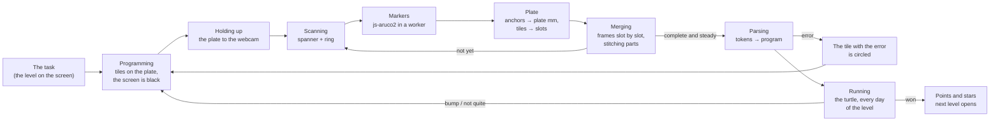
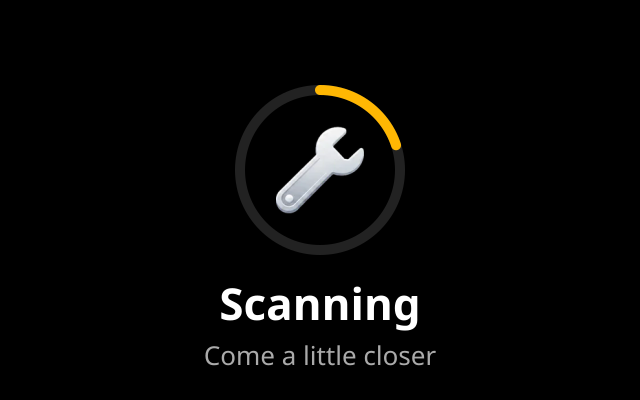
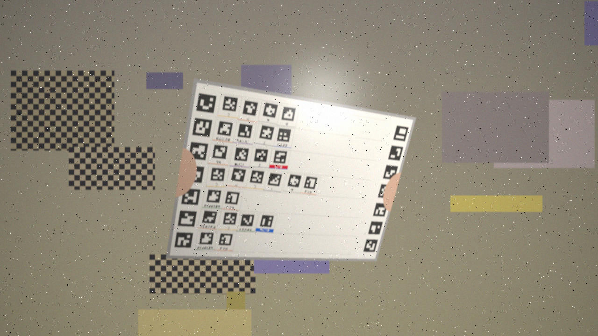
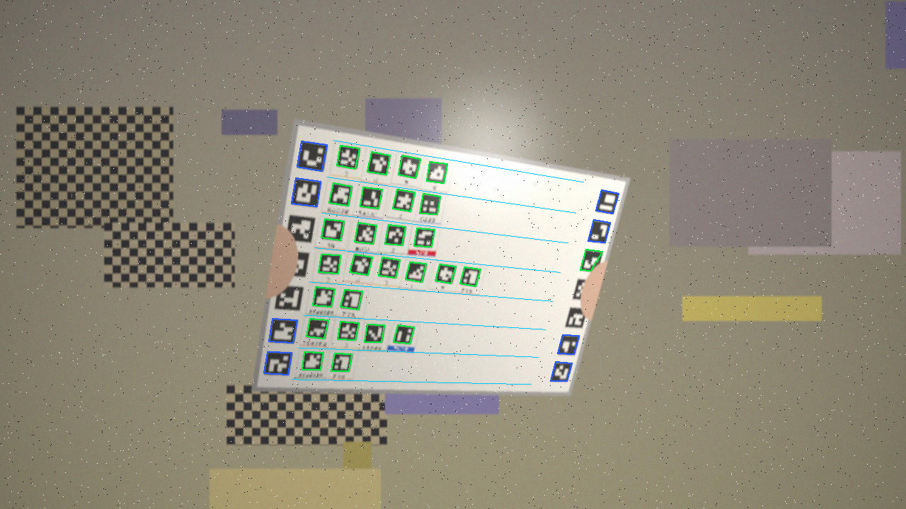
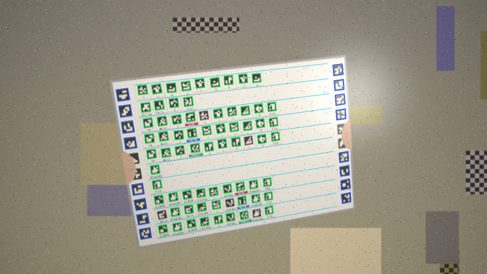
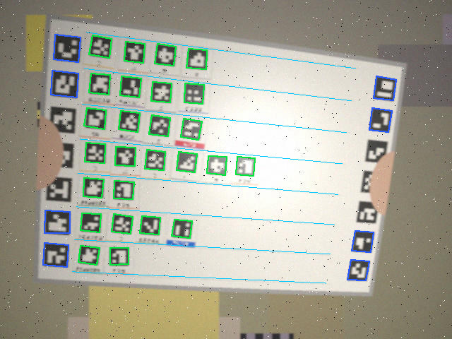
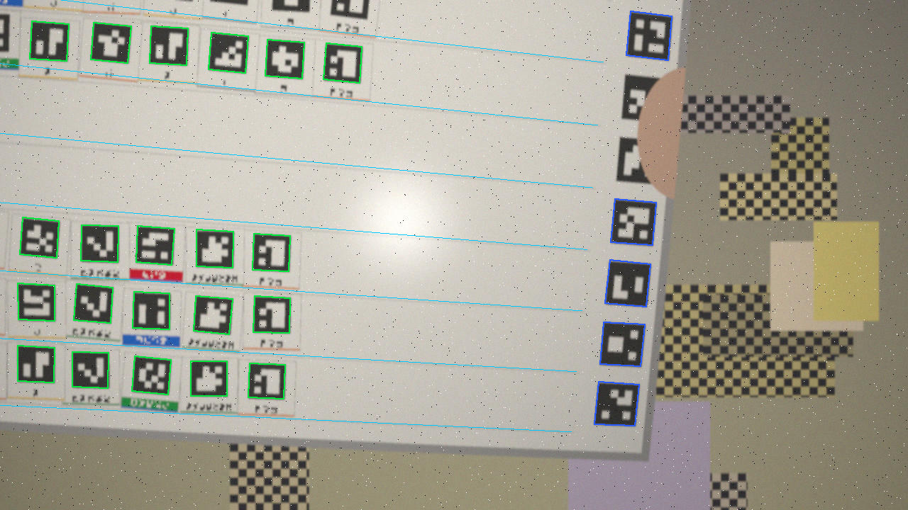

# Tactile Turtle

A programming puzzle game for children: they write programs with **magnetic tiles on a metal plate**, hold the plate up to the webcam, and a **robot turtle** on the screen carries the program out: picking up, dropping, switching on, sorting by colour, following lines, finding the way through mazes.

It runs in the browser (iPad or any laptop), the tiles are printed from PDFs in any language, and the language is real: `REPEAT`, `WHILE`, `IF`/`ELSE`, `FOR`, variables and procedures. See [DESIGN.md](DESIGN.md) for the whole design, and the [Manifesto](../MANIFESTO.md) for why.

## How it works



| While the children program | When they hold the plate up | When it is too small |
|---|---|---|
|  |  |  |

## A program running

Level 45, "Red left, blue right": the turtle sorts the boxes by their colour. The program on the right is what the children set on the plate; the tile being run lights up.



```
REPEAT 4
  IF COLOUR = RED PICK UP LEFT DROP RIGHT
  ELSE PICK UP RIGHT DROP LEFT END
  FORWARD
END
```

Level 92, "Follow the line": the turtle follows the blue line to the yellow cell at its end. Where the line bends, it looks left, and if that is not blue either, it turns around to the right.



```
WHILE HERE ≠ YELLOW
  IF COLOUR = BLUE OR COLOUR = YELLOW
    FORWARD
  ELSE
    LEFT
    IF COLOUR ≠ BLUE RIGHT RIGHT END
  END
END
```

Moving, turning, picking up and dropping are smooth; the look (grain in the sand, caustics in the sea, soft shadows, glowing lamps) comes from SVG filters, and the animations are SMIL, so the same picture plays in the game, in any browser and here. The sprites were generated with GenAI from the prompts in `dev/sprites/export_prompts.ts` and cut by `dev/sprites/import_sprites.py`; the turtle walks and turns in frames.

## The plate seen through a webcam

The end-to-end tests set a program on a plate and hold it up to a **virtual webcam**: a 720p (or 640 × 480) camera with a 65° lens, barrel distortion, defocus, uneven light and glare, trembling hands, motion blur, sensor noise, salt and pepper, and JPEG compression, like a laptop webcam sending MJPEG. The program must be read back exactly. Green: tiles found; blue: the anchors at the ends of the rows; cyan: the rows as the game understood them.

| A4 at 60 cm, 1280 × 720 | the same, as read |
|---|---|
|  |  |

| A3 at 70 cm, 1280 × 720 | A4 at 30 cm, 640 × 480 |
|---|---|
|  |  |

**Moved about and stitched:** held too close to be seen whole (A3 at 30 cm), the plate is moved in front of the camera; every frame is placed by the anchors it sees, and the parts are merged slot by slot.



What works (details in [DESIGN.md](DESIGN.md#cameras-distances-and-focus)): in 1280 × 720, A4 and A3 at 50–60 cm even when tilted, and at 70 cm when held fairly straight; in 640 × 480, A4 at about 30 cm, and A3 moved about at 25 cm. The game asks the browser for 1280 × 720; without asking, browsers give 640 × 480.

## Development

```
npm install
npm run dev            # the scanner page: http://localhost:5173 (D shows the camera)
npm test               # unit tests, levels, markers, end-to-end scans (~2 minutes)
npm run test:webcam    # every level's solution through the virtual webcam (~15 minutes)
npm run test:browser   # the built game in headless Chrome with a fake camera (needs google-chrome)
npm run build          # the static site in dist/
npm run docs           # the pictures of this README
npm run markers        # regenerate the marker dictionary (data/markers.json)
```

The printable PDFs (Python, WeasyPrint):

```
python3 -m venv venv && venv/bin/pip install -r dev/requirements.txt
venv/bin/python dev/print/generate_stickers.py      # print/*.pdf
npm run verify:print                                # read them back with the detector
```

On Debian/Ubuntu the PDFs need `fonts-noto-core fonts-dejavu-core fonts-tibetan-machine`, and the check needs `poppler-utils`.

Pushing a tag `v*` builds the game and the PDFs in every language and attaches them to the GitHub Release.

## License

See [LICENSE](LICENSE).
